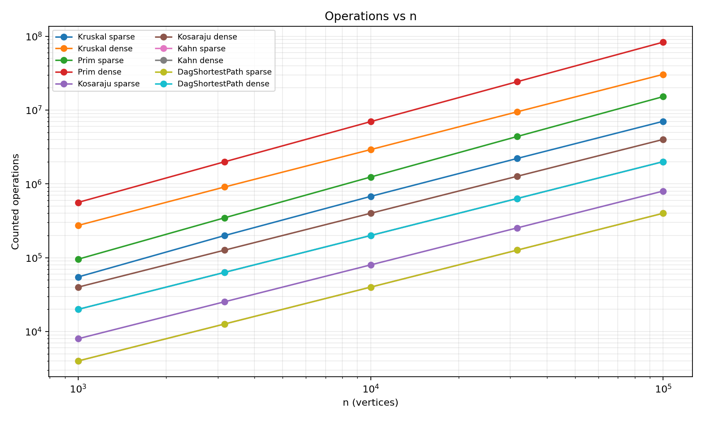
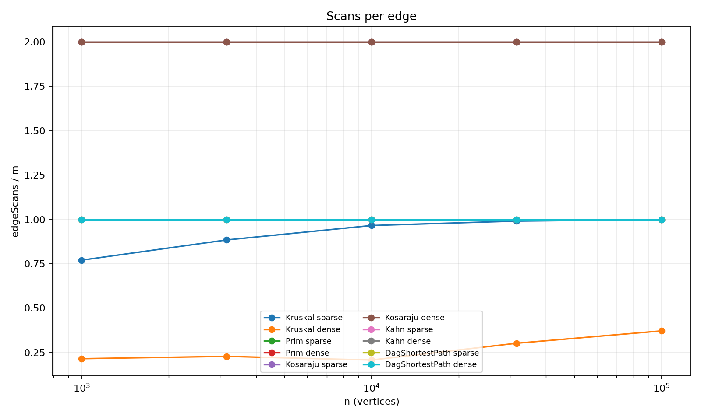
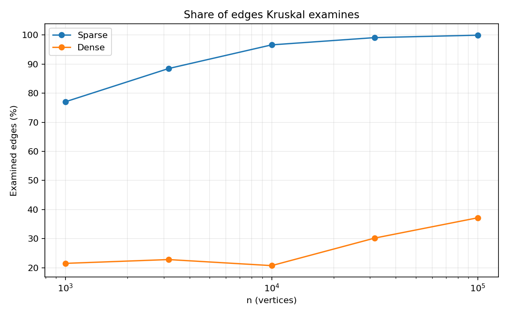

# Assignment 3 Report: Graphs

**Student:** Marlen Yerkinbayev  
**Group:** SE2518  
**Project:** DAA Assignment 3 - DSU, MST, SCC and Shortest Paths

## 1. Implementation Summary

The project uses one adjacency-list `Graph` class for directed and undirected weighted graphs. Vertices are numbered from `0` to `n-1`, and weights are `int`. The implemented algorithms are DSU with path compression and union by rank, Kruskal, Prim, Kosaraju, Kahn topological sorting, and shortest paths in a DAG. Kosaraju uses an explicit stack instead of recursion, so it is safe for the required graph with 100,000 vertices. The benchmark uses the exact `Random(42)` generator from the assignment, five graph sizes, and sparse (`m = 4n`) and dense (`m = 20n`) cases.

Counters are updated inside the algorithms. The main counted values are `dsuOps = find calls + successful unions`, `edgeScans`, `comparisons`, and `maxDepth`. For the first plot I use `counted operations = dsuOps + edgeScans + comparisons`. Time is the median of 5 runs, but the analysis below is based mainly on the operation counters.

## 2. Complexity Table

| Algorithm / operation | Time complexity | Extra space | Short justification |
|---|---:|---:|---|
| DSU `find` / `union` | amortized `O(alpha(V))` | `O(V)` | Path compression plus union by rank keeps trees very shallow. |
| Kruskal | `O(E log E)` | `O(V + E)` | Edges are sorted, then DSU checks whether an edge connects two different sets. |
| Prim | `O(E log V)` | `O(V + E)` | The adjacency list is scanned and candidate edges are stored in a priority queue. |
| Kosaraju | `O(V + E)` | `O(V + E)` | Two graph traversals are used: original graph and reversed graph. |
| Kahn | `O(V + E)` | `O(V)` | Each vertex enters the queue once and every directed edge decreases one in-degree. |
| DAG shortest paths | `O(V + E)` | `O(V)` | After topological ordering, every edge is relaxed once. |

`alpha(V)` is the inverse Ackermann function. In practical input sizes it is almost constant, which is why DSU operations are very fast.

## 3. Reference Values and Correctness Check

The benchmark automatically compares Kruskal and Prim, validates the topological order, and checks the required reference values. All ten generated graph cases matched the assignment table:

| Graph `n / m` | MST total weight | SCC count | Sum of DAG distances | Check |
|---:|---:|---:|---:|---|
| 1,000 / 4,000 | 147,970 | 27 | 396,274 | OK |
| 1,000 / 20,000 | 30,363 | 1 | 252,411 | OK |
| 3,162 / 12,648 | 468,911 | 137 | 1,271,911 | OK |
| 3,162 / 63,240 | 97,589 | 1 | 723,157 | OK |
| 10,000 / 40,000 | 1,486,139 | 373 | 3,941,828 | OK |
| 10,000 / 200,000 | 309,550 | 1 | 2,381,342 | OK |
| 31,623 / 126,492 | 4,715,515 | 1,188 | 12,551,891 | OK |
| 31,623 / 632,460 | 968,517 | 1 | 7,376,612 | OK |
| 100,000 / 400,000 | 15,012,094 | 3,923 | 40,096,539 | OK |
| 100,000 / 2,000,000 | 3,056,681 | 1 | 23,512,087 | OK |

Kosaraju also produced exactly `2m` edge scans for every graph. Kahn and the DAG relaxation produced exactly `m` edge scans. These checks are performed before the CSV row is written, so a wrong result stops the benchmark instead of producing misleading output.

## 4. Counters vs. Formulas

The table below shows ratios for the sparse graphs. A ratio staying approximately constant as `n` grows is evidence that the measured work follows the expected complexity class.

| n | Kruskal `dsuOps / E` | Kosaraju `edgeScans / (V+E)` | Kahn `edgeScans / (V+E)` | DAG SP `edgeScans / (V+E)` |
|---:|---:|---:|---:|---:|
| 1,000 | 2.290 | 1.600 | 0.800 | 0.800 |
| 3,162 | 2.519 | 1.600 | 0.800 | 0.800 |
| 10,000 | 2.682 | 1.600 | 0.800 | 0.800 |
| 31,623 | 2.732 | 1.600 | 0.800 | 0.800 |
| 100,000 | 2.748 | 1.600 | 0.800 | 0.800 |

For sparse graphs, `E = 4V`, so Kosaraju has `2E / (V+E) = 8V / 5V = 1.6`, while Kahn and the DAG relaxation have `E / (V+E) = 4V / 5V = 0.8`. The measured values stay exactly at these constants. Kruskal's DSU ratio also stays bounded and changes only slightly because the exact number of successful unions and examined edges depends on when the spanning tree becomes complete.

## 5. Correctness Arguments

### Cut property for Kruskal and Prim

Consider any cut that separates the vertices into two groups. If an edge has the minimum weight among all edges crossing this cut, adding this edge is safe for some minimum spanning tree. Kruskal processes edges from lightest to heaviest, so when it joins two different DSU components, the chosen edge is a light edge crossing the cut between those components. Therefore Kruskal never needs to add an edge that makes the MST heavier than necessary. Prim uses the same property from a different direction: it keeps one growing tree and repeatedly chooses the lightest edge leaving the current tree. That edge is the light edge of the cut between visited and unvisited vertices. Repeating this safe choice produces an MST for a connected graph. For a disconnected graph, the same logic is applied separately to each component, producing a minimum spanning forest.

### Induction on topological order for DAG shortest paths

In a topological order, every edge `u -> v` goes from an earlier vertex to a later vertex. All zero in-degree vertices start with distance `0`, which is equivalent to connecting a virtual super-source to them with zero-weight edges. Assume that when vertex `u` is processed, its distance is already the correct shortest distance. Every possible path to `u` can only use vertices that appear before `u`, so all edges that could improve `u` were already processed. Relaxing every outgoing edge of `u` then gives valid candidates for later vertices. By induction, each vertex has its final shortest distance when it is processed. Because a DAG has no directed cycle, a path cannot return to an earlier vertex, so one pass is enough. Negative edge weights are safe here because there is no negative cycle, while a general graph may contain a negative cycle that keeps decreasing path cost.

## 6. Which Algorithm When

| Situation | Choice | Reason |
|---|---|---|
| Undirected weighted graph, edge list available | Kruskal | Sorting edges is natural and DSU makes cycle checks cheap. |
| Undirected graph stored as adjacency list | Prim | It grows directly from adjacency lists using a priority queue. |
| Very dense MST graph | Prim can be competitive | It avoids sorting the entire edge list, although actual performance depends on representation and constants. |
| Need connected components under repeated unions | DSU | Almost-constant amortized `find` and `union`. |
| Directed graph, need SCCs | Kosaraju | Simple `O(V+E)` method and easy to validate; iterative DFS avoids stack overflow. |
| Need job order and graph must be acyclic | Kahn | Gives a topological order and detects a cycle if fewer than `V` vertices are removed. |
| DAG with possible negative weights | DAG shortest path | Linear `O(V+E)` relaxation; negative weights are safe because there are no cycles. |
| General graph with negative weights | Not DAG shortest path | Use another algorithm such as Bellman-Ford because cycles may exist. |

This table is the main practical decision rule: first check whether the graph is directed, whether cycles are possible, how the graph is represented, and whether weights may be negative.

## 7. Slope Check and Plots

Using log-log data and fitting a straight line to the counted-work curves gives these slopes:

- Kosaraju: sparse `1.00`, dense `1.00`.
- Kahn: sparse `1.00`, dense `1.00`.
- DAG shortest paths: sparse `1.00`, dense `1.00`.
- Kruskal: sparse `1.05`, dense `1.02`.

The traversal algorithms are almost exactly slope `1.00`, which agrees with linear `O(V+E)` work when density is fixed. Kruskal is slightly above `1` because sorting adds the logarithmic factor from `E log E`.

The scans-per-edge plot is mostly flat. Prim scans both adjacency-list directions in an undirected graph, so its ratio is about `2`. Kosaraju scans the original and reversed graph, also giving `2`. Kahn and DAG relaxation scan each directed edge once, giving `1`.

Kruskal can stop when a connected graph already has `V-1` chosen edges. On dense graphs it often finishes after examining a smaller share of the sorted edge list, while on sparse graphs it usually needs a much larger share.

## 8. Timing Note

For the largest dense case (`n = 100,000`, `m = 2,000,000`) this run measured: Kruskal: 519.385 ms, Prim: 1767.965 ms, Kosaraju: 514.333 ms, Kahn: 153.751 ms, DagShortestPath: 224.483 ms. These values are included in `results.csv`, but they are not the main proof of complexity. Wall-clock time changes with the CPU, JVM version, garbage collection, and other programs running on the computer. The operation counters and the exact reference results are reproducible, so they are stronger evidence for the analysis.

## 9. Testing

JUnit 5 tests cover all required checks. DSU is compared with a simple reference representation after random unions. Kruskal and Prim are compared on 100 random connected graphs and both must produce `n-1` edges. Kosaraju is compared with brute-force reachability on small random graphs. Kahn is tested on both a DAG and a directed cycle. DAG shortest paths are compared with Bellman-Ford on small DAGs with negative weights. Finally, Kosaraju is run on a directed path of 100,000 vertices to confirm that the iterative implementation does not throw `StackOverflowError`.
